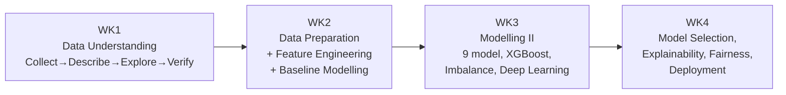

## Course Map

**AI Solutions Mastery / AI Practitioner Program** (Dr. Maryam Miradi) is a hands-on applied
Machine Learning course, taught through 4 Jupyter notebooks, following the **CRISP-DM** framework
(Cross-Industry Standard Process for Data Mining) end-to-end on ONE single dataset — UCI Adult
Census Income (predicting whether a person's income exceeds \$50K/year, based on US census data).
Using one dataset throughout is a deliberate pedagogical choice: each week isn't a new problem,
but a NEW LAYER of technique added onto the SAME problem, allowing direct comparison of each
technique's effectiveness.

## CRISP-DM Flow Across 4 Weeks

- **[[wk1-data-understanding]]** — Collect (loaded from UCI via `ucimlrepo`) → Describe (dtypes,
  NA, cardinality) → Explore (point-biserial correlation, network graph EDA) → Verify Data
  Quality (disguised `'?'` missing data, demographic skew → the course's EARLIEST fairness
  question). Practice counterpart: [[wk1-practice]] (UCI Bank Marketing, 92/100).
- **[[wk2-data-preparation-feature-engineering]]** — Select (unique ID via `uuid`, stratified
  split) → Format & Clean → Construct ([[sklearn-column-transformer-pipeline]],
  [[hierarchical-clustering-categorical-grouping]] grouping `occupation`) → 2 baseline models
  (Logistic Regression + Random Forest, 83-84% accuracy but only 0.64 minority-class F1 — the
  accuracy illusion leads straight into WK3).
- **[[wk3-modelling-imbalance-deep-learning]]** — switches fully to [[auprc]] as the official
  metric → compares 9 models ([[xgboost]] leads) → handles class imbalance
  ([[imbalanced-data-resampling]]: SMOTE beats ADASYN/Undersampling) → tunes ([[hyperopt-tpe]]) →
  Deep Learning (`tanh` + `categorical_crossentropy` bug → NaN) + [[ctgan]] oversampling.
- **[[wk4-model-selection-explainability-fairness-deployment]]** — the **54-combination grid** (9
  models × 6 strategies) → the course's biggest finding: high CV (XGBoost+CTGAN, 0.9639) does NOT
  guarantee a high real test-set score (0.7951, even losing to the non-resampled model's 0.8024)
  → expands into unsupervised learning ([[pca-tsne-dimensionality-reduction]],
  [[kmeans-dbscan-clustering]], [[anomaly-detection]]) → explainability ([[shap]]) → algorithmic
  fairness ([[fairlearn]] — finally addressing the question raised back in WK1) → deployment
  packaging (`joblib` + Streamlit scaffold).

## Threads Running Through the Course

See [[cumulative-quiz]] for all 6 cross-week comparisons in full (metric evolution, Random Forest
vs XGBoost, the cost of imbalance handling, data leakage in multiple forms, fairness from WK1's
question to WK4's tooling, WK1 EDA shaping WK2 feature engineering). These are connections that
don't fit neatly into one week but run through the whole course.

## Mindmap Artifact

A bilingual interactive Mindmap Artifact (claude.ai), with a tab per week (WK1–WK4) + 1
theme-organised cross-week "All" tab + 1 self-test tab. Does NOT auto-reflect `wiki/` changes —
must be manually resynced whenever a new week/concept is added (see the INGEST workflow in
CLAUDE.md).

Link: https://claude.ai/code/artifact/ee7189c4-001d-4d24-9662-8bc14e26b5d8 (private by default,
user chooses to share).

## Wiki Links

[[crisp-dm]] · [[wk1-data-understanding]] · [[wk2-data-preparation-feature-engineering]] ·
[[wk3-modelling-imbalance-deep-learning]] ·
[[wk4-model-selection-explainability-fairness-deployment]] · [[cumulative-quiz]] ·
[[maryam-miradi]]
