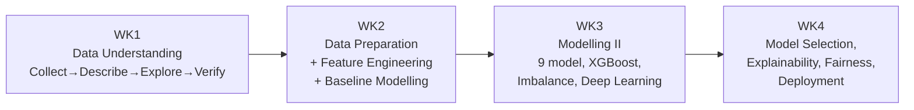

## Bản đồ môn học - Course Map

**AI Solutions Mastery / AI Practitioner Program** (Dr. Maryam Miradi) là môn học thực hành
Machine Learning ứng dụng, dạy qua 4 notebook Jupyter, bám sát khung **CRISP-DM** (Cross-Industry
Standard Process for Data Mining) xuyên suốt trên MỘT bộ dữ liệu duy nhất — UCI Adult Census
Income (dự đoán thu nhập cá nhân có vượt \$50K/năm hay không, dựa trên dữ liệu census Mỹ). Dùng 1
bộ dữ liệu xuyên suốt là chủ đích sư phạm: mỗi tuần không phải 1 bài toán mới, mà là 1 LỚP kỹ
thuật MỚI đắp lên CÙNG bài toán, cho phép so sánh trực tiếp hiệu quả từng kỹ thuật.
 **AI Solutions Mastery / AI Practitioner Program** (Dr. Maryam Miradi) is a
hands-on applied Machine Learning course, taught through 4 Jupyter notebooks, following the
**CRISP-DM** framework (Cross-Industry Standard Process for Data Mining) end-to-end on ONE single
dataset — UCI Adult Census Income (predicting whether a person's income exceeds \$50K/year, based
on US census data). Using one dataset throughout is a deliberate pedagogical choice: each week
isn't a new problem, but a NEW LAYER of technique added onto the SAME problem, allowing direct
comparison of each technique's effectiveness.

## Luồng CRISP-DM xuyên 4 tuần - CRISP-DM Flow Across 4 Weeks

- **[[wk1-data-understanding]]** — Collect (tải từ UCI qua `ucimlrepo`) → Describe (kiểu dữ liệu,
  NA, cardinality) → Explore (point-biserial correlation, network graph EDA) → Verify Data
  Quality (dữ liệu thiếu ngụy trang `'?'`, lệch nhân khẩu học → câu hỏi fairness đặt ra SỚM nhất
  môn học). Assignment đối chiếu: [[wk1-practice]] (UCI Bank Marketing, 92/100).
   Collect (loaded from UCI via `ucimlrepo`) → Describe (dtypes, NA,
  cardinality) → Explore (point-biserial correlation, network graph EDA) → Verify Data Quality
  (disguised `'?'` missing data, demographic skew → the course's EARLIEST fairness question).
  Practice counterpart: [[wk1-practice]] (UCI Bank Marketing, 92/100).
- **[[wk2-data-preparation-feature-engineering]]** — Select (unique ID qua `uuid`, stratified
  split) → Format & Clean → Construct ([[sklearn-column-transformer-pipeline]],
  [[hierarchical-clustering-categorical-grouping]] gộp `occupation`) → 2 model baseline
  (Logistic Regression + Random Forest, accuracy 83-84% nhưng F1 lớp thiểu số chỉ 0.64 — ảo giác
  accuracy dẫn thẳng tới WK3).
   Select (unique ID via `uuid`, stratified split) → Format & Clean →
  Construct ([[sklearn-column-transformer-pipeline]],
  [[hierarchical-clustering-categorical-grouping]] grouping `occupation`) → 2 baseline models
  (Logistic Regression + Random Forest, 83-84% accuracy but only 0.64 minority-class F1 — the
  accuracy illusion leads straight into WK3).
- **[[wk3-modelling-imbalance-deep-learning]]** — chuyển hẳn sang [[auprc]] làm thước đo chính
  thức → so sánh 9 model ([[xgboost]] dẫn đầu) → xử lý mất cân bằng lớp
  ([[imbalanced-data-resampling]]: SMOTE thắng ADASYN/Undersampling) → tinh chỉnh
  ([[hyperopt-tpe]]) → Deep Learning (bug `tanh`+`categorical_crossentropy` → NaN) + [[ctgan]]
  oversampling.
   Switches fully to [[auprc]] as the official metric → compares 9 models
  ([[xgboost]] leads) → handles class imbalance ([[imbalanced-data-resampling]]: SMOTE beats
  ADASYN/Undersampling) → tunes ([[hyperopt-tpe]]) → Deep Learning (`tanh`+
  `categorical_crossentropy` bug → NaN) + [[ctgan]] oversampling.
- **[[wk4-model-selection-explainability-fairness-deployment]]** — lưới **54 tổ hợp** (9 model ×
  6 chiến lược) → phát hiện lớn nhất môn học: CV cao (XGBoost+CTGAN, 0.9639) KHÔNG đảm bảo test
  set thật cao (0.7951, thua cả model không resample 0.8024) → mở rộng sang học không giám sát
  ([[pca-tsne-dimensionality-reduction]], [[kmeans-dbscan-clustering]],
  [[anomaly-detection]]) → giải thích được ([[shap]]) → công bằng thuật toán ([[fairlearn]] — xử
  lý đúng câu hỏi đặt ra từ WK1) → đóng gói triển khai (`joblib` + Streamlit scaffold).
   The **54-combination grid** (9 models × 6 strategies) → the course's
  biggest finding: high CV (XGBoost+CTGAN, 0.9639) does NOT guarantee a high real test-set score
  (0.7951, even losing to the non-resampled model's 0.8024) → expands into unsupervised learning
  ([[pca-tsne-dimensionality-reduction]], [[kmeans-dbscan-clustering]], [[anomaly-detection]]) →
  explainability ([[shap]]) → algorithmic fairness ([[fairlearn]] — finally addressing the
  question raised back in WK1) → deployment packaging (`joblib` + Streamlit scaffold).

## Chủ đề xuyên suốt - Threads Running Through the Course

Xem [[cumulative-quiz]] để đọc đầy đủ 6 so sánh xuyên tuần (tiến hóa thước đo, Random Forest vs
XGBoost, chi phí xử lý mất cân bằng, data leakage dưới nhiều hình thức, fairness từ câu hỏi WK1
tới công cụ WK4, EDA WK1 định hình feature engineering WK2). Đây là những mối liên hệ không nằm
gọn trong 1 tuần mà xuyên suốt cả môn học.
 See [[cumulative-quiz]] for all 6 cross-week comparisons in full (metric
evolution, Random Forest vs XGBoost, the cost of imbalance handling, data leakage in multiple
forms, fairness from WK1's question to WK4's tooling, WK1 EDA shaping WK2 feature engineering).
These are connections that don't fit neatly into one week but run through the whole course.

## Mindmap Artifact - Mindmap Artifact

1 Artifact mindmap tương tác song ngữ (claude.ai), có tab theo từng tuần (WK1–WK4) + 1 tab "Tất
cả" tổng hợp xuyên tuần theo chủ đề + 1 tab tự kiểm tra. KHÔNG tự động phản ánh thay đổi trong
`wiki/` — phải đồng bộ tay mỗi khi có tuần/concept mới (xem quy trình INGEST trong CLAUDE.md).
 1 bilingual interactive Mindmap Artifact (claude.ai), with a tab per week
(WK1–WK4) + 1 theme-organised cross-week "All" tab + 1 self-test tab. Does NOT auto-reflect
`wiki/` changes — must be manually resynced whenever a new week/concept is added (see the INGEST
workflow in CLAUDE.md).

Link: https://claude.ai/code/artifact/ee7189c4-001d-4d24-9662-8bc14e26b5d8 (private mặc định,
người dùng tự chọn share).
 Link: https://claude.ai/code/artifact/ee7189c4-001d-4d24-9662-8bc14e26b5d8
(private by default, user chooses to share).

## Liên kết wiki - Wiki Links

[[crisp-dm]] · [[wk1-data-understanding]] · [[wk2-data-preparation-feature-engineering]] ·
[[wk3-modelling-imbalance-deep-learning]] ·
[[wk4-model-selection-explainability-fairness-deployment]] · [[cumulative-quiz]] ·
[[maryam-miradi]]
